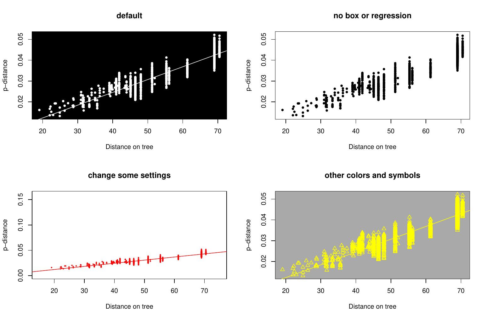

# Saturation plots



## Description

Code for generating saturation plots used in [Klopfstein et al.,
2013](https://doi.org/10.1371/journal.pone.0069344) for displaying the
relationship between the uncorrected (P-) distance and the distance on a
phylogenetic tree.

## Requirements

[R](https://www.r-project.org/) with R-package
[ape](https://cloud.r-project.org/web/packages/ape/index.html).
Recently tested with R v4.6.2 and ape v5.8-1.

## Installation

```R
remotes::install_github("nylander/saturation.plot")
```

## Input

1. Multiple sequence alignment in fasta format ([example](inst/extdata/data.fas))
2. Tree with tip labels corresponding to sequence labels
   ([example](inst/extdata/tree.phy))

## Examples

```R
remotes::install_github("nylander/saturation.plot")

library(saturation.plot)

?saturation.plot

tree <- ape::read.tree(
  system.file("extdata", "tree.phy", package = "saturation.plot")
)
ultrametric <- ape::read.tree(
  system.file("extdata", "ultrametric.phy", package = "saturation.plot")
)
dna <- ape::read.dna(
  system.file("extdata", "data.fas", package = "saturation.plot"),
  format = "fasta"
)

saturation.plot(tree, dna)

third_pos <- dna[, seq(3, ncol(dna), by=3)]
firstsecond_pos <- dna[, -seq(3, ncol(dna), by=3)]

par(mfrow=c(2, 3))

saturation.plot(tree, dna, main="Default")
saturation.plot(tree, dna, main="Background, no regression line",
    bg=TRUE, regr=FALSE)
saturation.plot(tree, dna, main="Change some settings",
    bg=FALSE, col="red", ylim=c(0, 0.08), cex=0.5)
saturation.plot(tree, dna, main="Other colors and symbols",
    bg=TRUE, col="yellow", bg.col="darkgray", reg.col="red",
    pch=24, cex=1.5, lwd=2)
saturation.plot(ultrametric, dna, main="Use ultrametric tree")
saturation.plot(tree, firstsecond_pos, main="Codon pos 1st+2nd vs. 3rd",
    regr=FALSE, col="red", ylim=c(0, 0.15))
saturation.plot(tree, third_pos,
    bg=FALSE, regr=FALSE, col="blue", ylim=c(0, 0.15), add=TRUE)
legend(x="topright", legend=c("3rd", "1st+2nd"),
    col=c("blue", "red"), pch=20, bty="n")
```
